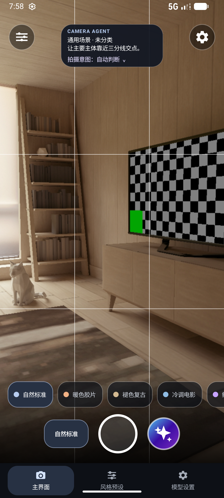

# Camera Agent

Camera Agent 是一款 Android 相机 MVP，尝试把实时取景、本地场景分析、拍摄参数调整、风格预设和云端 AI 拍摄建议放进同一条拍摄流程。普通相机、端侧场景分析和本地照片处理可离线使用；只有用户主动请求 AI 建议时，应用才会把一帧取景图发送到所配置的云端服务。

> 当前版本：`0.1.0`（Git 标签：`v0.1.0`）。该版本是预发布版本：产品负责人最终验收和多品牌 Android 真机验证仍待完成。

## 软件预览

下图为当前版本运行于 Android 37 模拟器的相机主界面。画面中的客厅和色卡来自模拟器摄像头场景，不代表真实手机拍摄效果。

<p align="center">
  
</p>
<p align="center"><sub>取景页包含场景建议卡、构图辅助线、横向风格预设、快门、AI 拍摄入口和底部导航。</sub></p>

## 当前功能

### 相机与场景提示

- 使用 CameraX 打开后置相机取景并拍照；支持的 Android 版本范围为 Android 10 及以上（API 29+）。
- 提供三分构图辅助线、端侧场景提示、人脸区域提示和设备能力报告。
- 根据设备实际能力启用变焦和曝光补偿；设备不支持的控制会禁用或按能力降级。
- 支持辅助/自动调整模式。可用能力由设备和厂商实现决定，应用不会假设所有手机支持相同的相机参数。

### 本地风格预设与照片处理

内置 8 种预设：

| 预设 | 风格方向 |
| --- | --- |
| 自然标准 | 保留现场色彩 |
| 暖色胶片 | 暖色、高光柔和 |
| 褪色复古 | 低反差、轻微褪色 |
| 冷调电影 | 冷色氛围、加强层次 |
| 鲜活夜色 | 提升色彩表现 |
| 柔和人像 | 柔和反差、偏暖肤色 |
| 鲜润美食 | 提升食物色彩 |
| 银盐黑白 | 黑白影调 |

- 可调整预设强度、曝光、对比度、高光、阴影、色温、色调和饱和度；也可保存个人配方。
- 取景中的实时颜色是独立覆盖层提供的轻量色调提示，不会改写 CameraX 相机帧；保存照片时再由本地处理流程应用完整配方。因此，取景提示与最终成片可能存在差异。
- 拍摄后可比较原片与处理结果、调整预设强度，并选择保存原片或处理后的照片。

### 云端 AI 拍摄建议

- 支持 OpenAI-compatible Chat Completions 接口，可在应用内配置服务地址、路径、模型和 API Key。默认服务地址为 `https://api.deepseek.com`，默认模型为 `deepseek-flash`。
- 只有用户主动点击发送/AI 拍摄入口后才发起请求；不做后台采集或低频轮询。客户端不设固定请求冷却时间，但同一时间只允许一个请求执行。
- 每次请求包含一张当前取景 JPEG 和结构化场景/相机信息。图片最长边不超过 1024 像素，压缩后不超过 512 KB；图片仅在内存中处理，不保存到本地，并在编码前去除 EXIF 信息。
- 应用校验云端响应、建议时效、数值范围及设备能力后，才应用支持的曝光、变焦、预设或构图建议；页面显示执行结果，并提供撤销入口。
- 用户可显式选择 AI 建议应用后自动拍摄一次；默认仍由用户按快门。
- 模型/API 服务必须支持 OpenAI-compatible 图片输入。用户配置的服务商会收到图像和结构化信息；服务商的隐私政策、数据留存、配额和费用由用户自行确认。

## 拍摄流程

1. 打开应用并允许相机权限，进入实时取景。
2. 选择本地风格预设，按需调整曝光、变焦或其他可用控件。
3. 如需云端指导，主动点击 AI 入口发送当前画面；普通拍摄不需要配置网络服务。
4. 检查建议及其执行状态，必要时撤销；手动按快门，或在应用内明确开启 AI 建议后的单次自动拍摄。
5. 在拍摄结果页比较原片和处理结果，调整强度并保存。

## 技术方案

| 层次 | 技术与职责 |
| --- | --- |
| Android 应用 | Kotlin、原生 View、单 Activity；相机页面和部分流程编排目前集中在 `MainActivity` |
| 相机 | CameraX Preview、ImageCapture、ImageAnalysis；公开 Android 相机 API，无需 root |
| 端侧分析 | ML Kit 图像标签与人脸检测，生成基础场景/构图提示 |
| 本地影调 | `PhotoPreset` 管理预设和配方；`PhotoColorProcessor` 处理成片；`CompositionOverlayView` 绘制取景提示 |
| 云端请求 | `OpenAiCompatibleClient` 发送显式触发的多模态请求；`CloudImageEncoder` 限制图片尺寸和体积 |
| 数据存储 | Android 私有 SharedPreferences 保存设置和预设；API Key 使用 Android Keystore 加密；照片写入系统媒体库 |

主要代码位置：

```text
app/src/main/java/com/example/cameraagent/
├── MainActivity.kt             # 页面、相机生命周期与主要流程编排
├── AgentCaptureContext.kt      # AI 拍摄意图与会话上下文
├── AgentConfigStore.kt         # 服务配置及 API Key 存储
├── AgentSceneAnalyzer.kt       # 端侧场景、人脸与画面分析
├── CameraCapabilityReport.kt   # 相机能力读取与报告
├── CloudImageEncoder.kt        # 单帧图片压缩与编码
├── CompositionOverlayView.kt   # 构图、人脸、裁剪和影调提示
├── OpenAiCompatibleClient.kt   # OpenAI-compatible 云端请求
├── PhotoColorProcessor.kt      # 拍摄照片的本地影调处理
├── PhotoCropProcessor.kt       # AI 裁剪结果处理
├── PhotoPreset.kt              # 预设、配方和本地预设存储
└── PresetPreviewEffect.kt      # 轻量取景色调提示计算

docs/                            # 产品、技术、设备验收和研究文档
openspec/                        # 分阶段需求与设计规格
scripts/verify-mvp.ps1           # 构建与 APK 权限检查，可选设备验证
```

## 构建与运行

### 环境要求

- Android Studio（安装 Android SDK Platform 35）
- JDK 17
- Gradle Wrapper 9.6.0（项目通过 `gradlew.bat` 使用）
- Android 设备或模拟器：Android 10 / API 29 或更高版本

### 在 Android Studio 中运行

1. 克隆仓库并在 Android Studio 中打开项目根目录。
2. 等待 Gradle Sync 完成，确认本机已安装 Android SDK Platform 35 和 JDK 17。
3. 连接 Android 手机或启动模拟器，选择 `app` 配置并运行。
4. 首次启动时允许相机权限；不配置 Agent 服务也可使用本地相机与影调功能。

### 命令行构建

在 PowerShell 项目根目录执行：

```powershell
.\gradlew.bat :app:assembleDebug
```

生成的调试 APK 位于：

```text
app/build/outputs/apk/debug/app-debug.apk
```

### 发布前检查

仓库脚本会构建 Debug APK，并检查打包后的相机/网络权限。设置好 `ANDROID_SDK_ROOT` 后执行：

```powershell
.\scripts/verify-mvp.ps1 -AndroidSdkRoot $env:ANDROID_SDK_ROOT -BuildOnly
```

若连接且只连接一台已授权的 Android 设备，可省略 `-BuildOnly`；也可显式传入设备序列号：

```powershell
.\scripts/verify-mvp.ps1 -AndroidSdkRoot $env:ANDROID_SDK_ROOT -DeviceSerial "设备序列号"
```

设备模式会安装 APK、授予相机权限、启动应用、检查进程和近期崩溃日志，并将运行截图保存至 `build/verification/`。脚本检查不替代真人对构图、影调、真机兼容和云端模型输出的验收。

## 权限与隐私

- `CAMERA`：实时取景、场景分析和拍照所需。
- `INTERNET`：只用于用户主动发送的云端 AI 请求；本地取景、端侧分析、拍照和本地影调不依赖网络。
- 不申请广泛存储权限；照片使用 Android MediaStore 写入系统相册，通常位于 `Pictures/CameraAgent`。
- 不持续上传预览帧或视频。发送 AI 请求时，当前帧与结构化相机信息会传往应用中配置的 HTTPS 服务。
- API Key 在本机加密存储，界面显示时会脱敏。不要将真实 Key 放入代码、文档、截图或提交记录。

## 当前状态与已知限制

- GitHub 版本：`v0.1.0`，预发布；应用版本：`versionName=0.1.0`、`versionCode=1`。
- Android 37 模拟器已用于基础构建和部分相机流程验证；README 预览图就是当前版本的模拟器截图。
- 至少两家不同厂商 Android 真机的兼容性、预设切换后的预览稳定性、真实云端服务和模型输出仍待验收。
- 当前取景影调为轻量覆盖提示，保存照片才应用完整配方；第三方应用无法复现各手机厂商私有 ISP 和计算摄影效果。
- 相机功能取决于设备能力。手动 ISO、快门时间、白平衡、镜头选择及更完整的 Camera2/视频控制尚未接入。
- 当前仓库仅验证 Debug 构建，没有配置正式发布签名；`v0.1.0` GitHub 预发布未附可供正式分发的 APK。

## 项目文档

- [产品设计与交互方向](docs/PRODUCT_DESIGN.md)
- [MVP 技术设计与阶段状态](docs/MVP_TECHNICAL_DESIGN.md)
- [设备能力矩阵与验收清单](docs/DEVICE_CAPABILITY_MATRIX.md)
- [云端 Agent 拍摄指导设计](docs/AGENT_GUIDANCE_DESIGN.md)
- [后续阶段云端 Agent 设计](docs/NEXT_PHASE_CLOUD_AGENT_DESIGN.md)
- [影调预设调研](docs/PHOTO_PRESET_RESEARCH.md)
- [Android UI 组件说明](docs/ANDROID_UI_COMPONENTS.md)
- [相机页视觉设计](docs/CAMERA_UI_VISUAL_DESIGN.md)
- [OpenSpec 需求规格](openspec/)

## 许可证

当前仓库尚未声明开源许可证；如需公开再分发或作为依赖使用，请先联系项目维护者确认授权。
